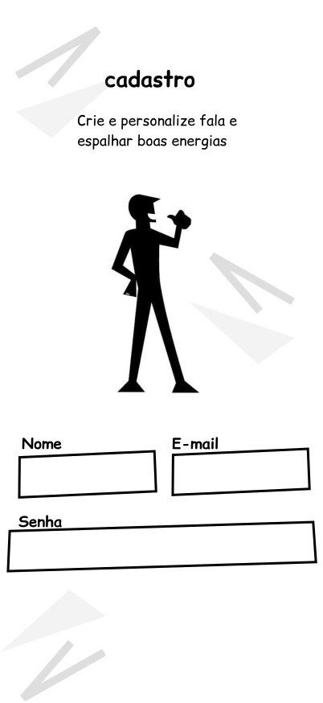

# PI 2°Semestre

# para cada tela do protótipo que exibe ou coleta dados, indicar quais entidades e atributos ela envolve

---

Entidade: `bajulador`, `categoria` e `fala`

- `bajulador`: `id_bajulador`, `nome`, `descricao`, `icone`.
- `categoria`: `id_categoria`, `nome`.
- `fala`: `id_fala`, `texto`, `id_bajulador`, `id_categoria`.

Operação: `SELECT` para exibir os bajuladores, suas imagens e as categorias; consulta de `fala` quando o usuário aciona o botão de bajular.

Entidade: `bajulador`

- `id_bajulador`
- `icone`

Operação: `SELECT`, para exibir os ícones disponíveis, e `UPDATE` se a escolha for salva em um bajulador já existente.

O campo `icone` armazena a referência à imagem escolhida.

Entidades: `fala`, `categoria` e `bajulador_categoria`

- `fala`: `id_fala`, `texto`, `id_bajulador`, `id_categoria`.
- `categoria`: `id_categoria`, `nome`.
- `bajulador_categoria`: `id_bajulador`, `id_categoria`.

Operações: `SELECT` para mostrar as falas disponíveis e registrar quais foram escolhidas; `INSERT` se as falas forem cadastradas como novos registros.

Entidade: `usuario`

- `id_usuario`
- `nome`
- `senha`

Operação: `UPDATE`, para atualizar os dados do usuário.

O botão “Mudar” permite escolher outra imagem de perfil. Como seu SQL atual não tem um campo de foto na tabela `usuario`, será necessário adicionar um atributo, por exemplo `icone` ou `foto_perfil`, se quiser persistir essa escolha.

Entidade: `bajulador`

- `id_bajulador`
- `nome`
- `descricao`
- `icone`
- `id_usuario`
- `numero_slot`

Entidades complementares:

- `categoria`: `id_categoria`, `nome`.
- `bajulador_categoria`: `id_bajulador`, `id_categoria`.

Operação: `INSERT` para criar o bajulador e registrar as categorias selecionadas

Entidades: `usuario` e `bajulador`

- `usuario`: `id_usuario`, `nome`, `email`.
- `bajulador`: `id_bajulador`, `nome`, `icone`, `id_usuario`.

Operação: `SELECT` para consultar os dados do perfil e listar os bajuladores; `DELETE` ao excluir um bajulador.

Entidade: `bajulador`

- `id_bajulador`
- `id_usuario`
- `numero_slot`

Operação: `SELECT`, para consultar os slots ocupados, e `INSERT`, ao criar um bajulador.

A tela representa os três espaços disponíveis para cada usuário

Entidade: `usuario`

- `id_usuario` — identificador gerado automaticamente.
- `nome` — nome informado.
- `email` — e-mail informado.
- `senha` — senha armazenada com hash seguro.

Operação: `INSERT`, para cadastrar um novo usuário.